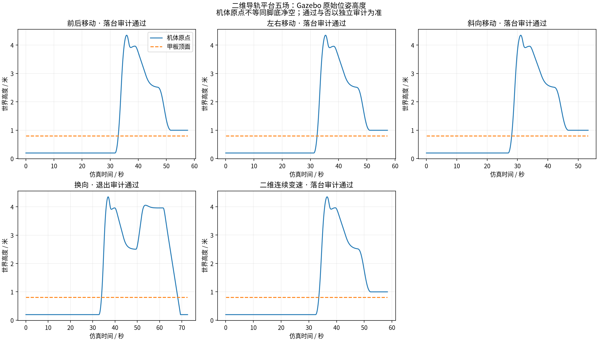
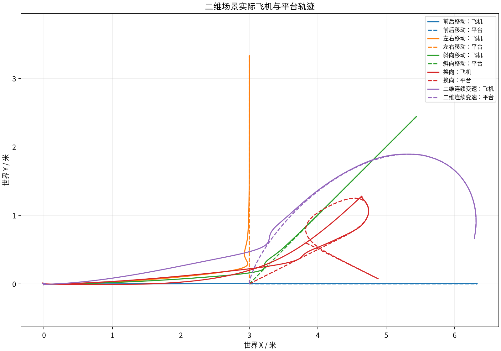

# 功能验收结果（2026-11-02）

用户明确以“功能实现和演示”为目标，已取消原92场大样本/压力计划。保留完成的小样本复测5/5严格通过，再运行原二维5个基础场景，5/5满足各自原声明。

基础回归共实际尝试6场，其中原左右场发生时钟/机体观测通信中断，不能验收，原始记录与审计错误保留；仅补跑同一左右场。5个场景的最终有效记录实际4场落台、1场安全退出。安全退出验证保护功能，不算落台成功；原换向场景允许安全退出，不能把所有completed统称成功。总计10/10满足各自声明；本次原始/专项审计共54份通过，请求历史完整性结果见JSON。

| 基础场景 | 实际结局 | 是否符合原声明 |
|---|---|---|
| 前后移动 | landing | True |
| 左右移动 | landing | True |
| 斜向移动 | landing | True |
| 换向 | safe_exit | True |
| 二维连续变速 | landing | True |

运行控制代码 `748b27e28be42ad294769105c5c899d3e9ecfb25`。200项Linux完整测试通过，含真实Gazebo模型解析，无跳过；重启后再次核验环境与解析器。控制算法、安全门限、原甲板/机体几何不变。复测是原4m高净空单次换向专项（X2/Y2/XY1），基础回归保留原1.5m跟随profile和五个真实场景；两类初态不同，不做性能提升比较。

A组原30场中其余25场按用户要求停止，没有当作失败或悄悄删除。初始重复批次另有1次主机重启中断（与基础左右场通信中断分开记录），原数据及中断前索引保留，不能计通过。后续不再自动执行其余压力/边界/旧九场矩阵；旧92场文件仅作历史计划。

目前可以确认声明仿真条件下的跟随、重新跟随、落台与安全退出功能。不是任意未来运动、真实感知链或真机验证。按用户精简同步选择上传曲线、完整审计、实际配置/模型、关键原始记录和可分析抽样；全频率物理位姿、完整控制/反馈、DataFlash和所有请求响应留本机并归档。抽样不是完整原始数据，同盘归档不称异地备份。

