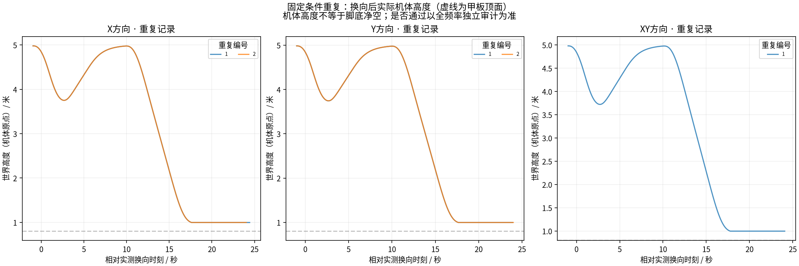
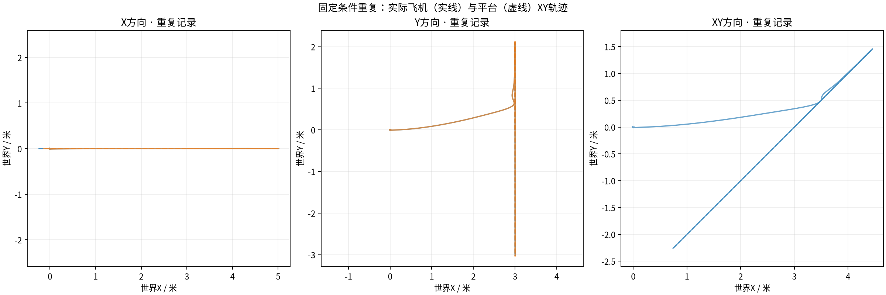

# 小样本重新跟随功能复测（2026-11-02）

用户最新明确以功能实现与演示为目标，取消大样本压力/边界验证。已完成并保留5场重复，其中严格成功5/5；X/Y/XY分组见实验结果.json。原A30中的其余25场按用户要求取消，不记为算法失败，也不列为必须完成的待办。停止由目标调整决定，并非挑选成功样本。

实际代码 `748b27e28be42ad294769105c5c899d3e9ecfb25`，控制算法基于58065a9；仅补记录/证据管理。原始及专项审计通过30份，请求历史检查通过5场。Linux200项测试通过（含实际Gazebo解析，无跳过）；主机重启后重新核对环境和解析器。前次重启中断1次单独保留，没有替换成通过。

各场保持原4m高净空、3.4—3.85m实测下降触发和6/8/10s候选，未启用观测压力。速度/加速度/jerk、接触、整机几何、40s任务、25s等待和最多3次恢复等原门限全部保留。参考运动/引导实测/原生起飞及接触冲击的统计区间不混用。完整请求1至末次连续留存，末次与邮箱一致，每个保留响应有原始请求。

| 场次 | 结局 | 触发→重新跟随 s | 速度峰值 m/s | 加速度峰值 m/s² |
|---|---|---:|---:|---:|
| A_X_01 | complete_function_success | 0.759999999999998 | 1.6945950828795247 | 1.3999227990266983 |
| A_Y_01 | complete_function_success | 0.759999999999998 | 1.5512885382132444 | 1.4000295192091938 |
| A_XY_01 | complete_function_success | 0.8000000000000043 | 1.644806051780347 | 1.4005257466498768 |
| A_X_02 | complete_function_success | 0.759999999999998 | 1.6947935265518812 | 1.4038490384068205 |
| A_Y_02 | complete_function_success | 0.7600000000000051 | 1.5523412749008674 | 1.4016717458147343 |

本组用于说明关键流程能实现且有少量重复成功证据，不保证任意运动或真机能力。再做原二维五场功能回归，不继续原92场计划。此前先导三场、界面演示和环境中断不混入这组成功分母。

原始全频率物理位姿、完整控制/反馈、DataFlash与全部请求响应留本机；GitHub精简同步完整审计、事件链、实际配置、关键原始片段、曲线和绘图抽样。抽样不替代全频率审计，同盘归档不称异地备份。

