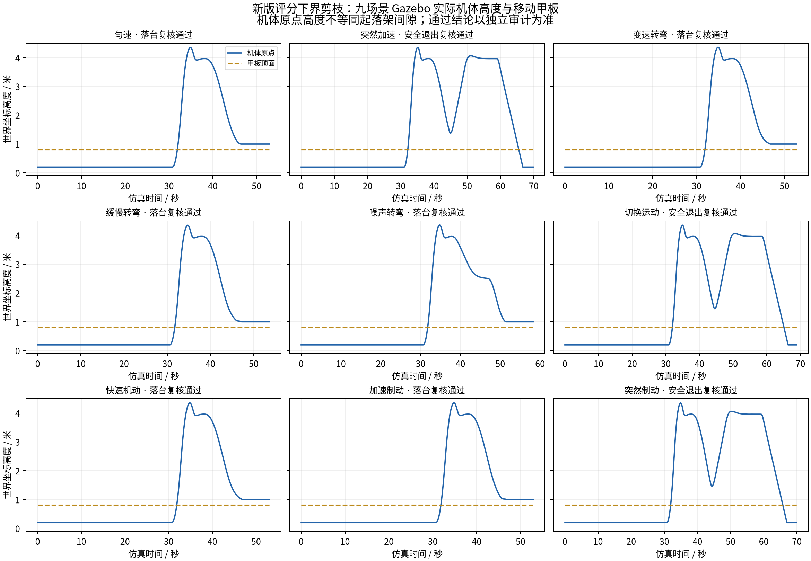
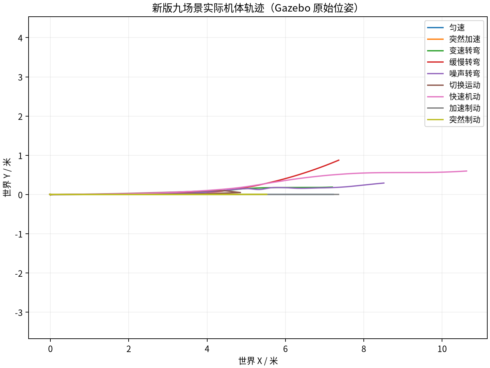

# 新版评分下界剪枝：九场景物理仿真结果（2026-10-30）

固定代码提交：`922f9d8478a5727f50f6067bb6ed0e1ad7983bc8`。新声明：`score_pruning_20261030_v1`。独立数据目录：`session_001`。历史 session_002 及协议 v30 原记录保持原样；旧版通过结论不用于验证新代码。

本轮完成 9 个场景，独立审计确认 6 场真正落台、3 场安全退出；9/9 满足声明。共执行 36 次逐场独立审计，审计及声明核验：全部通过。退出不算落台。

| 场景 | 独立审计结果 | 满足声明 | 速度峰值 m/s | 加速度峰值 m/s² | 跳过候选 / 总候选 |
|---|---|---|---:|---:|---:|
| 匀速 | 真正落台 | 是 | 1.5079 | 1.0114 | 41 / 82 |
| 突然加速 | 安全退出 | 是 | 1.5097 | 1.3150 | 29 / 64 |
| 变速转弯 | 真正落台 | 是 | 1.6122 | 1.4295 | 13 / 88 |
| 缓慢转弯 | 真正落台 | 是 | 1.5579 | 1.1111 | 37 / 94 |
| 噪声转弯 | 真正落台 | 是 | 1.7166 | 1.3781 | 34 / 57 |
| 切换运动 | 安全退出 | 是 | 1.5303 | 1.2197 | 3 / 64 |
| 快速机动 | 真正落台 | 是 | 1.6470 | 1.0850 | 34 / 88 |
| 加速制动 | 真正落台 | 是 | 1.6387 | 1.2585 | 37 / 89 |
| 突然制动 | 安全退出 | 是 | 1.6438 | 1.2471 | 17 / 59 |

新版 531 个包文件通过逐文件完整性校验；容器中 137 项单元回归测试全部通过。实际部署与每场规划工作进程的规划器 SHA256 均为 `4b1bfdfb89f99951fdb17a36901c4978d369d4b38cebe2e713bbe083de631356`。控制配置（除场景列表）、物理模型、飞控参数和全部安全门限沿用旧版；只有评分下界剪枝规划代码更新，并生成独立声明。

每场使用原有因果预测审计、原生 LAND 与正常解锁/停转审计、实际接触/退出审计、原始 COM 运动审计。审计程序未修改。审计所用原始位姿日志经 gzip 无损压缩，解压后 SHA256 与压缩前一致；DataFlash、控制记录、逐次求解器请求响应和每场源码均保留。

最高采样速度 1.716588 m/s，最高采样加速度 1.429537 m/s²，对应原门限 3.0 m/s 和 1.5 m/s²。统计区间为原优化引导及完整引导返航区间，不含原生起飞、接触冲击和地面 LAND；属于原始位姿的 COM 修正与有限差分采样统计。

本次实际记录 685 个候选，其中 245 个因评分下界跳过，占 35.77%。`solved_candidates` 统计 `solve()` 调用（包括几何预检拒绝），不是底层锥优化器调用数。该数据说明本轮实际发生的候选裁剪；本次未运行同输入的完整搜索配对耗时实验，不能据此宣称确定的加速倍数。新增单元测试包含剪枝与完整搜索选择结果对照。

运行环境沿用 Ubuntu 24.04 隔离容器、Gazebo Harmonic、固定版本 ArduCopter 与 Gazebo 插件；本轮重新检查了依赖版本、原模型来源、固件哈希、桌面场景和飞控未解锁状态。纯软件渲染，不暴露 DRI 设备。

结果仅覆盖声明的固定高度水平小甲板和九个场景，不构成任意运动平台或真机保证。

