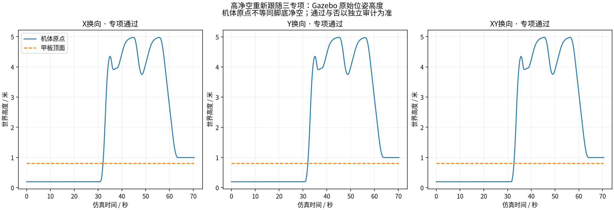
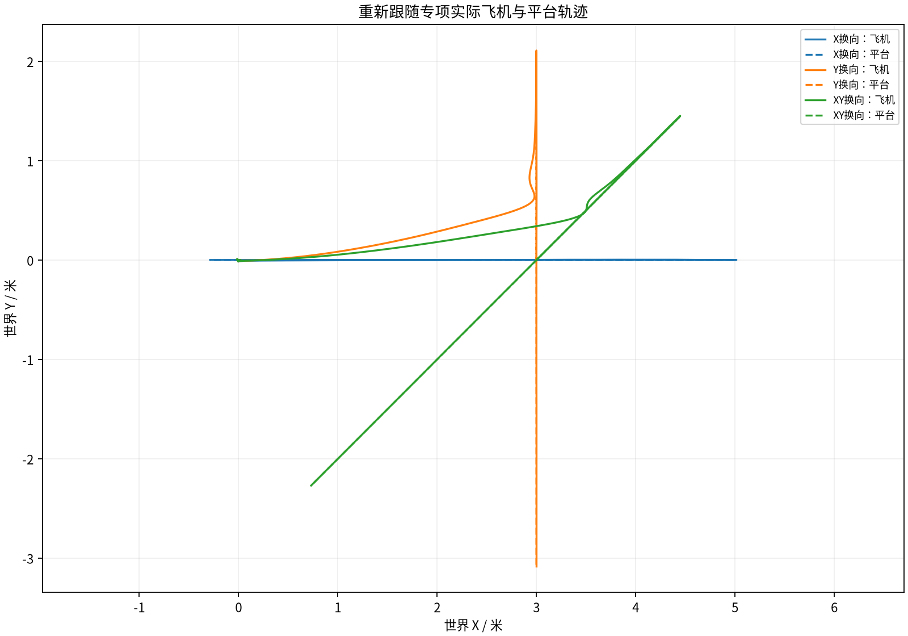

# 高净空换向后重新跟随专项（2026-11-02）

代码固定提交 `ca86ce7cf8c8ee1a392a23867296718b7583d59e`，专项实现 `58065a94335388d6b698f9463cf30185fc4d3cfa`。本轮仅使用“毕设仿真”，不处理“论文仿真”。正式独立批次 session_001。

本轮 3 场，3/3 满足严格专项要求。安全退出、只跟随、只对齐、未触发、缺少新规划或缺少真实接触，均不计专项成功。实际结果如下：

| 场景 | 专项结果 | 重新跟随次数 | 原始反向证据 | 飞机速度峰值 m/s | 飞机加速度峰值 m/s² |
|---|---|---:|---|---:|---:|
| X换向 | 通过 | 1 | True | 1.6935370492130837 | 1.3996649339574445 |
| Y换向 | 通过 | 1 | True | 1.553031141299981 | 1.4012528065979977 |
| XY换向 | 通过 | 1 | True | 1.6444610524757723 | 1.400395559639537 |

Linux容器内190项测试全部通过，包含实际Gazebo SDFormat解析，无跳过。运行前核对固定固件、Gazebo插件来源、依赖、几何参考与GTK面板。实际部署源码逐场核对；本机监督器仅适配命名分区、增加源码/配置检查和面板早期检查，差异保存在 supervisor_adapter.diff，控制算法与门限保持。

本轮是独立4m脚底跟随净空初态，实测TRACKING下降至3.4—3.85m且竖直速度<-0.02m/s时只触发一次平台反向；X、Y目标为±0.25m/s，XY为两个分量±0.18m/s；指令仍经0.8m/s、0.12m/s²、0.3m/s³合成限幅及关节有界力控制。新候选时长6/8/10s，不与旧1.5m初态作性能优劣比较。原总任务40s、累计等待25s、最多3次重新跟随、飞机3m/s与1.5m/s²、发送jerk4m/s³、接触及支撑门限保持。

专项审计核对同一控制时刻的实际脚底净空、下降速度和TRACKING阶段，真实PLANAR_REACQUIRE控制记录，其后ALIGNMENT_COMPLETE与新PLAN_ACTIVATED早于原始接触，以及平台受测轴从正向转负向且至少连续4个速度区间为负。并独立重跑因果策略、原生LAND/非强制停转、接触/支撑、原始飞机COM运动和平台物理审计。逐项结果见实验结果.json和cases内完整报告。旧排他审计报告的重算记录由专项工具保存在reacquisition_audit_replays，原字节保留。

飞机运动统计覆盖初始跟随、下降、重新跟随及完整引导返航（如发生）；原生起飞、接触冲击与地面LAND不混入该区间。平台位姿按原30Hz发布，用原60ms新鲜度检查；无人机原始间隔不超过25ms。全频率原始位姿的SHA、控制历史、DataFlash、进程保留的原始请求响应和模型留在Linux并做全量归档。现有程序会覆盖request.json，因此仅保留末次原始请求，不能声称每次原始请求都已保存；全部编号响应、请求序号事件和关键控制片段保留。按用户既有精简同步选择，GitHub同步曲线、绘图抽样、审计、实际配置与关键原始片段，未将抽样称为完整原始数据。

此处只确认声明场景及实际记录。当前专项并未启用旧noisy_maneuvering专用合成噪声/延迟。若专项通过，后续仍需不同初始误差、触发时刻、观测条件的重复试验，以及旧基础矩阵回归；不宣称任意未来运动或真机保证。

