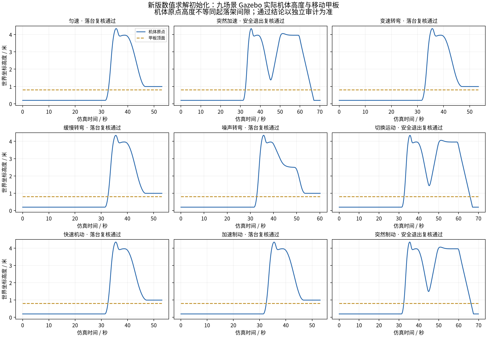
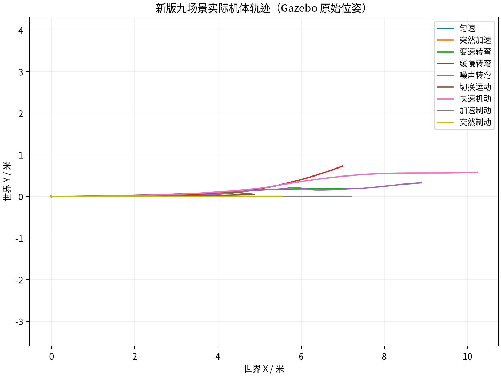

# 新版求解器数值初始化：九场景物理仿真结果（2026-10-30）

固定代码提交：`773994da0a2b72d7b7cf4e437a8846d9a31363fc`。新声明：`fresh_numeric_solver_20261030_v1`。独立数据目录：`session_003`。历史两轮验收及协议 v30 原记录保持原样；本轮中断的 session_001 与面板故障的 session_002 均单独保留并排除在正式九场之外；旧版通过结论不用于验证新代码。

本轮完成 9 个场景，独立审计确认 6 场真正落台、3 场安全退出；9/9 满足声明。共执行 36 次逐场独立审计，审计及声明核验：全部通过。退出不算落台。

| 场景 | 独立审计结果 | 满足声明 | 速度峰值 m/s | 加速度峰值 m/s² | 跳过候选 / 总候选 |
|---|---|---|---:|---:|---:|
| 匀速 | 真正落台 | 是 | 1.5051 | 1.0086 | 29 / 76 |
| 突然加速 | 安全退出 | 是 | 1.5032 | 1.3202 | 29 / 64 |
| 变速转弯 | 真正落台 | 是 | 1.6657 | 1.4214 | 16 / 82 |
| 缓慢转弯 | 真正落台 | 是 | 1.5530 | 1.1232 | 32 / 82 |
| 噪声转弯 | 真正落台 | 是 | 1.7301 | 1.3990 | 25 / 57 |
| 切换运动 | 安全退出 | 是 | 1.5316 | 1.2547 | 2 / 63 |
| 快速机动 | 真正落台 | 是 | 1.6297 | 1.0730 | 31 / 86 |
| 加速制动 | 真正落台 | 是 | 1.5991 | 1.3419 | 29 / 81 |
| 突然制动 | 安全退出 | 是 | 1.5885 | 1.2424 | 16 / 58 |

迁移后“毕设仿真”目录的 660 项文件清单通过校验；两份历史文档的过期清单哈希在迁移时已修正，算法字节保持不变；容器中 142 项单元回归测试全部通过。实际部署与每场规划工作进程的规划器 SHA256 均为 `aefdf969ee234635c577225b33ad3f58f69d9fb8a6e0adaa2326e78936d664d0`。控制配置（除场景列表）、物理模型、飞控参数和全部安全门限沿用旧版；本轮仅更新规划器数值求解初始化代码，并生成独立声明。

每场使用原有因果预测审计、原生 LAND 与正常解锁/停转审计、实际接触/退出审计、原始 COM 运动审计。审计程序未修改。审计所用原始位姿日志经 gzip 无损压缩，解压后 SHA256 与压缩前一致；DataFlash、控制记录、逐次求解器请求响应和每场源码均保留。

最高采样速度 1.730122 m/s，最高采样加速度 1.421396 m/s²，对应原门限 3.0 m/s 和 1.5 m/s²。统计区间为原优化引导及完整引导返航区间，不含原生起飞、接触冲击和地面 LAND；属于原始位姿的 COM 修正与有限差分采样统计。

本次实际记录 649 个候选，其中 209 个因评分下界跳过，占 32.20%。`solved_candidates` 统计 `solve()` 调用（包括几何预检拒绝），不是底层锥优化器调用数。该数据说明本轮实际发生的候选裁剪；本次未运行同输入的完整搜索配对耗时实验，不能据此宣称确定的加速倍数。新增单元测试覆盖长短时域切换、模板复用、平移、不可行后的恢复以及求解器异常拒绝。

运行环境沿用 Ubuntu 24.04 隔离容器、Gazebo Harmonic、固定版本 ArduCopter 与 Gazebo 插件；本轮重新检查了依赖版本、原模型来源、固件哈希、桌面场景和飞控未解锁状态。纯软件渲染，不暴露 DRI 设备。

结果仅覆盖声明的固定高度水平小甲板和九个场景，不构成任意运动平台或真机保证。

环境补充：session_001 在主机重启后未能留下完整九场记录；session_002 因 GTK 面板 MIT-SHM BadAccess 提前终止，原失败审计保留。使用 host IPC 命名空间修复图形共享内存，并独立验证面板存活后，session_003 完成正式九场。上述环境修复未改变控制源码、物理参数或验收门限。

工程范围：代码已移至 GitHub `毕设仿真/`（目录迁移提交 23f9720），迁移未改变算法字节；本次没有执行“论文仿真”中的代码。
