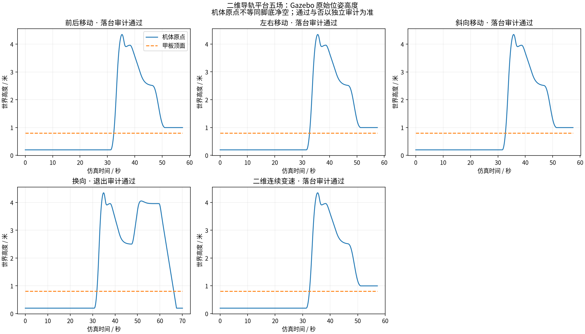
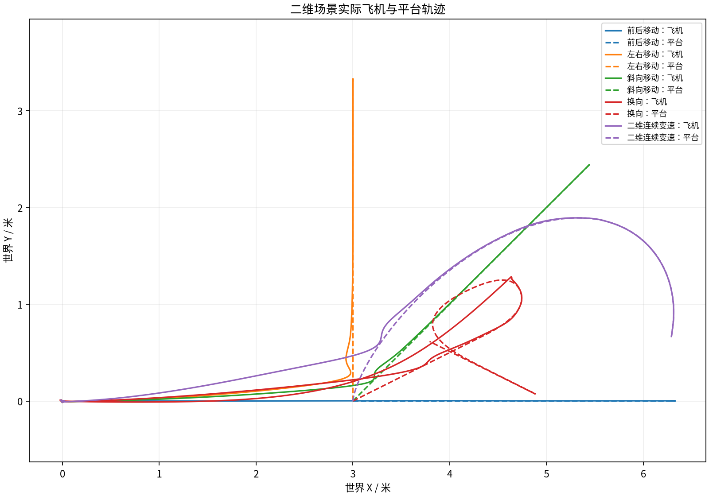

# 二维平台五场物理仿真（2026-11-01）

代码来自固定提交 `d3c0f17ab2f99fbd853d1a1217abdabeef8b3101`，范围为 `毕设仿真/`。物理模型生成器另修正一处 SDF 坐标系声明：`world` → `__model__`；控制算法、关节轴向、力控参数、原机体与甲板、飞行/接触门限保持。上游代码不能直接称为未经修改即通过，实际运行差异见 fixture_frame_fix.diff 和 supervisor_adapter_final.diff。

本轮独立 session_004 完成 5 场：4 场真正落台、1 场核验退出，5/5 满足配置声明。退出不计作落台。全部独立审计通过：True。

| 场景 | 配置期望 | 实际核验 | 满足期望 | 飞机速度峰值 m/s | 飞机加速度峰值 m/s² |
|---|---|---|---|---:|---:|
| 前后移动 | landing | 真正落台 | 是 | 1.6101385461457245 | 1.373354419560177 |
| 左右移动 | landing | 真正落台 | 是 | 1.545212991326496 | 1.3746549233023226 |
| 斜向移动 | landing | 真正落台 | 是 | 1.578381524733311 | 1.3736081693537565 |
| 换向 | landing_or_safe_exit | 核验退出 | 是 | 1.6829391448537232 | 1.3746131955466296 |
| 二维连续变速 | landing | 真正落台 | 是 | 1.6052906031194243 | 1.37208219341927 |

176 项回归测试及 6 项补充审计测试通过。新增 SDFormat 解析回归先复现失败，再修正坐标系后通过；原 chassis XML 内容保持。原始包及修正后的源码差异保留。

每场执行新版因果策略/不确定性回放、原 DataFlash 原生 LAND/非强制停转、按原计算和门限扩展到 PLANAR_FOLLOW 的飞机 COM 运动审计，以及新增平台原始物理位姿核验；真正落台场景还执行原独立接触/停转后支撑审计。旧退出审计含 DiffDrive 与急加速/急刹专用事件，不能用于新 XY 导轨，补充审计保留原 5 cm 正净空、8 cm 返回误差/速度、3 cm 地面高度门限，单独记录差异。策略回放不单独构成物理落台结论。

平台实际合成速度、加速度峰值与各轴位移/速度范围见 实验结果.json。平台按模型实际 30 Hz 位姿发布频率核查，位姿新鲜度沿用原平台匹配的 60 ms；无人机原始采样间隔仍严格不超过 25 ms，速度/加速度门限不变。初版审计误用平台 25 ms 间隔的失败日志保留。实际速度比较配置的 0.8 m/s 上限。指令 0.12 m/s² 与 0.3 m/s³ 是指令限幅，不被冒充为实际平台响应保证。各轴 1 cm 的位移判据仅检验运动激励证据；实际速度方向是否反向以记录的速度分量为准。飞机运动峰值沿用原引导区间，包含跟随/下降/完整引导返航，不含原生起飞、接触冲击和地面 LAND。

session_001 为桌面 DBus 环境变量缺失导致的起飞前初始化失败；session_002 因 SDF 轴坐标系解析错误未进入物理飞行。上述记录及 session_003 的主机重启中断记录均保留并排除于正式五场。

本轮未观测到 PLANAR_REACQUIRE 事件，因此重新跟随分支的物理衔接、预算耗尽等覆盖仍需独立专门场景；单元测试通过不替代这项物理验证。

原始 Gazebo 位姿经无损压缩并校验，DataFlash、全部控制记录、求解请求响应、原始/生成模型及失败审计留在本机，另做全量归档。GitHub 同步轻量资料。物理平台属于新的固定高度、固定朝向两轴力驱动导轨，不称为旧差速车；当前结果仅覆盖本轮记录，不宣称任意运动/长期防滑保证。

