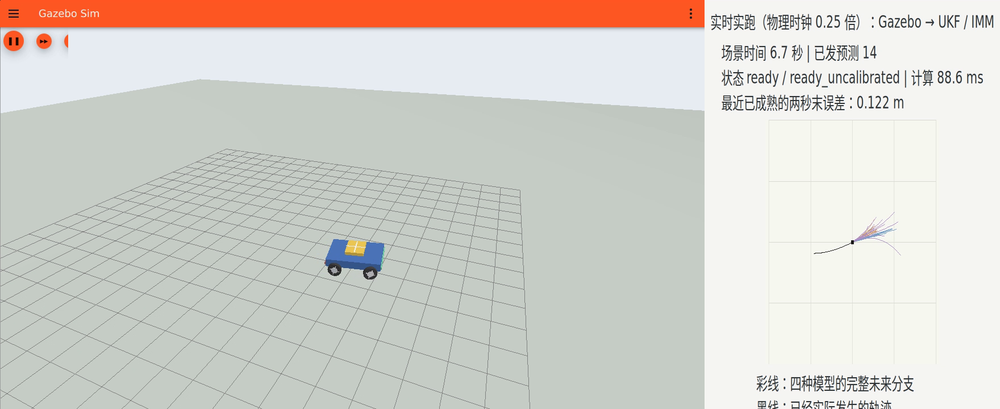

# 第六阶段：实际车辆与实时预测双窗录像

[观看或下载实跑视频](live_prediction.mp4) · [阶段成果汇报要点](阶段成果汇报.md) · [运行结果](prediction_summary.json) · [录制核验](recording_verification.json) · [北京时间记录](仿真时间记录.md)

<video src="live_prediction.mp4" controls></video>

左边是当前桌面前台原生 Gazebo 中的四轮车辆，右边是在线 UKF/IMM 预测面板。FFmpeg 在运行过程中同时采集两个所属原生窗口，实时拼接成同一个视频；没有用历史预测文件重建本视频，也没有用示意车辆替代 Gazebo 画面。

黑线表示已经收到的实际车辆轨迹；彩线表示四种运动模式的有限样本未来分支。彩线不是车辆实际走过的路径，也不代表车辆必然沿某一条线行驶。部分分支允许减速及倒车，不能把向后分支直接解释为算法已经知道车辆要倒车。

## 本次运行与读数

| 项目 | 结果 |
|---|---|
| 场景 | 四轮车辆持续转弯，无无人机飞控 |
| 北京时间开始 | 2026-11-07 10:11:02.717 |
| 北京时间结束 | 2026-11-07 10:12:41.184 |
| 实际耗时 | 98.466684 秒 |
| 已记录原始位姿时间跨度 | 23.018 秒 |
| 编码视频时长 | 96.50 秒；录屏起止不等于整个启动与清理过程 |
| 原生物理时钟速率 | 0.25 倍；不是墙上时钟一秒对应一秒的实时性能证明 |
| 视频格式 | H.264，1760×720，10 fps，2,741,450 字节 |
| 发布预测 | 40 次，其中 1 次预热，39 次可用；可用率 97.5% |
| 稳态完成评分预测 | 36 次 |
| 稳态平均位置误差 ADE | 约 3.06 厘米 |
| 稳态末目标位置误差 FDE | 约 7.66 厘米 |
| 预测计算耗时 | 中位数 87.95 毫秒，95 分位 108.63 毫秒（本机墙上时钟） |
| 实际运动检查、录像完整解码、所属进程退出 | 均通过 |

预测的最后目标是源快照之后约两秒的位置；计算和交付会消耗一部分时间，因此交付时剩余预测时域略短。末段用于等待预测目标实际发生并完成误差评分，预测面板的发布计数不会一直增加。

本次展示沿用此前独立车辆预测版本及参考点标定，不冒充无人机闭环参数版本的新复测。无人机闭环源码、独立核验和适用范围见[既有闭环交付](../../releases/native_closed_loop_20261107.md)。

## 版本、证据与范围

[声明配置及源码哈希](declared_protocol.json)保存预测配置、参考点标定来源和在线捕获程序哈希；[文件校验清单](PUBLISH_MANIFEST.json)包含视频及必要证据的文件大小与哈希。视频 SHA-256：`4e672d94791b83bebb0e1eb804a07539aa801b3440c2a3242ef28f38a89e6503`。

本目录只发布这一轮核验通过的实跑及必要证据。此前启动失败、预测过期失败及系统中断仍留本机，不上传失败日志，不将所选成功样本写成全部尝试均成功。高频原始数据不重复上传。本视频属于 Gazebo 物理仿真，不代表实体硬件测试；有限样本范围没有部署概率覆盖保证，也不是确定性可达外包。
